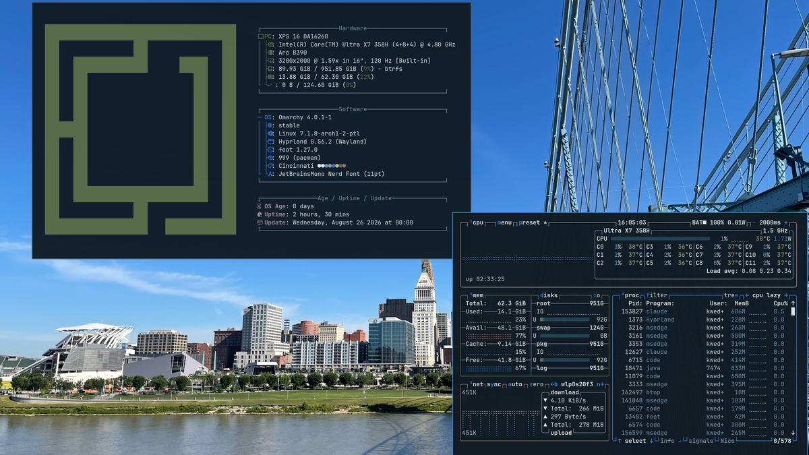

# Cincinnati for Omarchy

Deep river-navy, bridge-cable blue, and warm skyline neutrals. Cincinnati is
built from the actual colors in a photo of the Roebling Suspension Bridge and
the downtown skyline across the Ohio River, giving Omarchy a calm, low-glare
palette that stays easy on the eyes for long sessions.



## Install

Open the Omarchy Menu with `Super + Space`, then choose **Install > Style > Theme** and paste:

```text
https://github.com/jkwuc89/omarchy-cincinnati-theme
```

Or install it from a terminal:

```bash
omarchy theme install https://github.com/jkwuc89/omarchy-cincinnati-theme
```

The theme is applied immediately. To return to it later, use **Style > Theme**
or press `Super + Ctrl + Shift + Space`.

Already installed an older version? Update all third-party themes, then select
Cincinnati again:

```bash
omarchy theme update
```

## Palette

| Role | Hex | Preview |
|---|---|---|
| Background | `#101B25` |  |
| Selection | `#234152` |  |
| Foreground | `#DFE6E4` |  |
| Accent | `#3A82DB` |  |
| Blue | `#2E72CA` |  |
| Cyan | `#5B96B8` |  |
| Green | `#5A6B45` |  |
| Yellow | `#C9B77E` |  |
| Orange | `#C08A5E` |  |
| Red | `#9C6B63` |  |
| Brown | `#8C8664` |  |
| Magenta | `#A98F95` |  |

Every color was sampled directly from the source photo (bridge steel, river,
skyline stone, and riverbank grass), then adjusted only as far as needed for
legible contrast against the dark background.

## What gets themed

Cincinnati uses Omarchy's semantic `colors.toml` palette. Omarchy generates and
reloads its supported integrations whenever the theme is selected, so
everything from the shell to the terminal stays consistent from one file.

## Customize

Installed themes live in `~/.config/omarchy/themes/`. The only file that
defines Cincinnati is `colors.toml`. After making a change, select the theme
again to regenerate and reload its integrations.

## Credits

Palette sampled from a personal photo of the Roebling Suspension Bridge and
the Cincinnati skyline. Released under the [MIT License](LICENSE).
