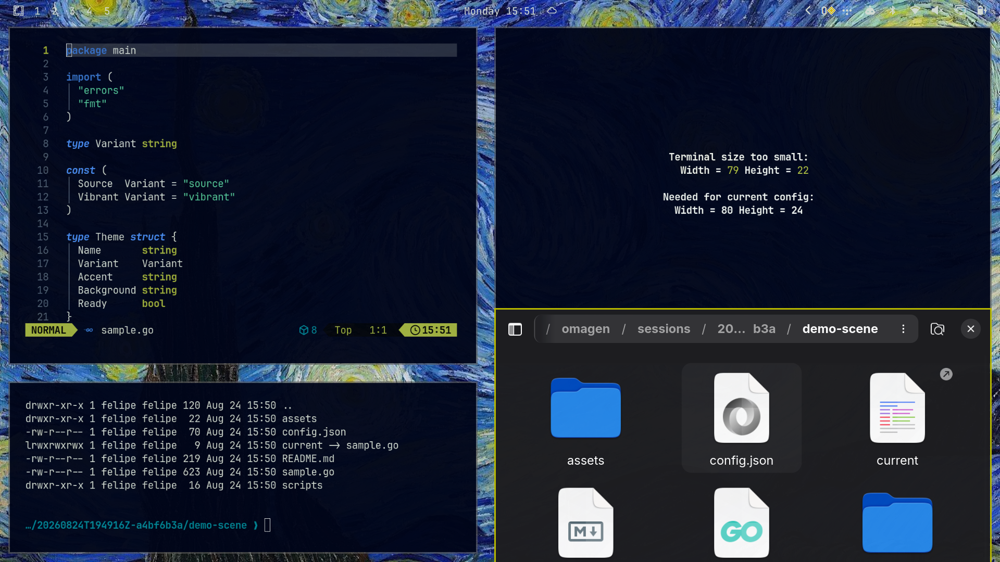

# Starry Night

An [Omarchy](https://omarchy.org) theme with a deep midnight-blue background,
a warm golden accent, and a muted, low-saturation palette — built to feel like
a clear night sky.



## Install

```bash
omarchy theme install https://github.com/juangalt/omarchy-starry-night-theme.git
```

Or clone it manually into `~/.config/omarchy/themes/starry-night` and run:

```bash
omarchy theme set "Starry Night"
```

## Palette

| | |
|---|---|
| Background | `#000519` |
| Foreground | `#d1dad3` |
| Accent | `#baba00` |
| Selection | `#102858` |

See [`colors.toml`](colors.toml) for the full palette.

## License

MIT — see [LICENSE](LICENSE).
